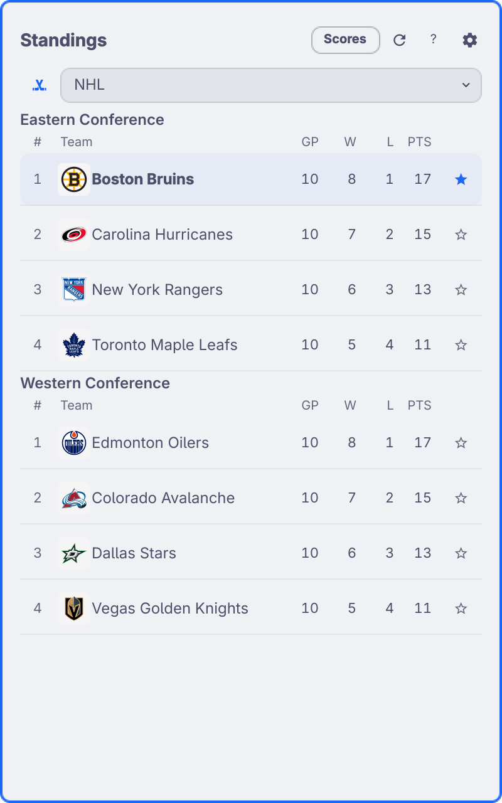
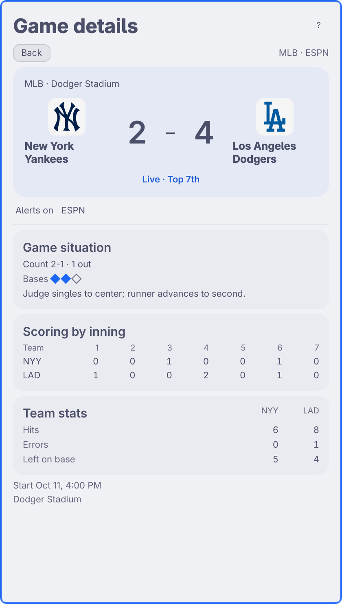
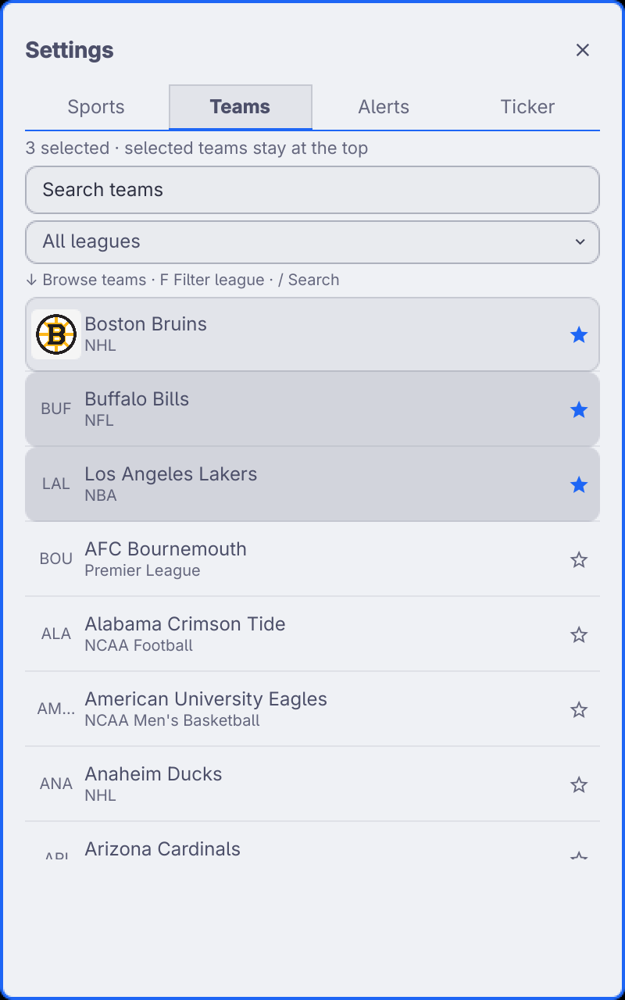
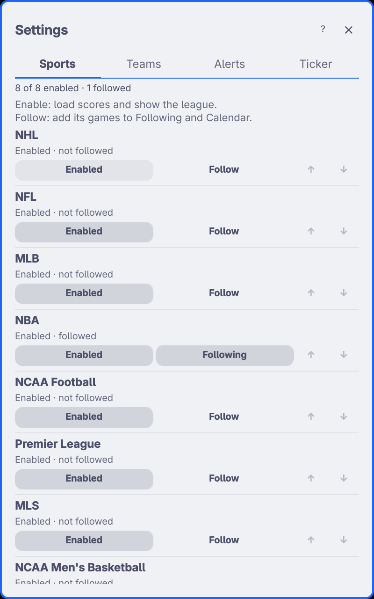
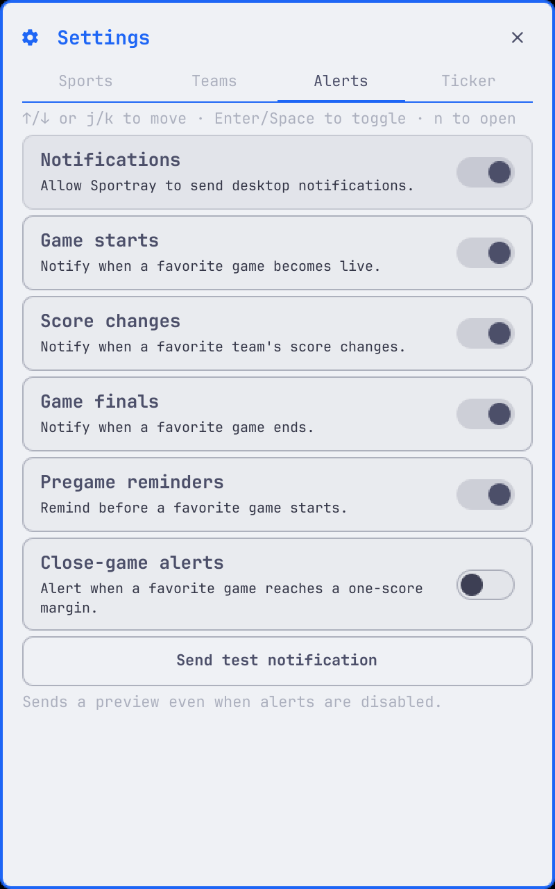

# Sportray

Scores, standings, and game alerts in your Omarchy bar.

Follow your teams, check the next matchup, or open a game's details without
leaving your desktop. Sportray is a native Omarchy / Quattro bar widget with a
compact scores panel and a scrolling ticker.

- **Favorite-first** — Keep favorite teams, watched games, and followed leagues
  together in Following.
- **Eight leagues** — Hockey, football, baseball, basketball, and soccer in one
  league chooser.
- **No account or API key** — Direct provider requests, local preferences, and
  no backend or telemetry.

[Install](#install) · [Follow your teams](#follow-your-teams) · [Scores & standings](#scores-and-standings) · [Ticker & alerts](#ticker-and-alerts) · [Keyboard](#keyboard) · [Troubleshooting](#troubleshooting)

<table>
  <thead>
    <tr><th>Following</th><th>Standings</th><th>Game details</th></tr>
  </thead>
  <tbody>
    <tr>
      <td valign="top" align="center"><a href="screenshots/sportray-following.png"></a></td>
      <td valign="top" align="center"><a href="screenshots/sportray-standings.png"></a></td>
      <td valign="top" align="center"><a href="screenshots/sportray-details.png"></a></td>
    </tr>
  </tbody>
</table>

<table>
  <thead>
    <tr><th>Favorite teams</th><th>Sports &amp; leagues</th><th>Game alerts</th></tr>
  </thead>
  <tbody>
    <tr>
      <td valign="top" align="center"><a href="screenshots/sportray-favorites.png"></a></td>
      <td valign="top" align="center"><a href="screenshots/sportray-leagues.png"></a></td>
      <td valign="top" align="center"><a href="screenshots/sportray-notifications.png"></a></td>
    </tr>
  </tbody>
</table>

_Select an image to enlarge it. Screenshots show illustrative games, standings,
and preferences in the stock Catppuccin Latte theme. Sportray follows your
active Omarchy theme._

## Install

On Omarchy 4 with the Quattro shell:

```bash
omarchy plugin add https://github.com/joega/sportray.git --enable
```

Sportray uses the system Python runtime included by Omarchy. It does not install
packages, request privileged access, create a service, or overwrite user
configuration. This candidate is tested with **Omarchy 4.5.0**, **Quickshell
0.3.2.r7**, and **Qt 6.12**.

Click the bar widget to open today's scores. On Omarchy 4.5, the panel follows
the widget's bar section and supports horizontal and vertical bars.

## Follow your teams

Open **Settings → Favorite teams** to search by team or filter by league.
Favorites stay at the top of the picker and pin their games in league views.

**Following** brings together favorite-team games, temporary game watches, and
slates from leagues you follow. Under **Settings → Sports & leagues**:

| Control | What it does |
| --- | --- |
| **Enable** | Fetch the league's scores and make its view available. |
| **Follow** | Include the enabled league in Following and promote it in navigation. |
| **Reorder** | Change followed-league order. Disabling a league also removes it from the followed set. |

Use **Watch** on a score row or in game details to receive alerts for that game
without favoriting either team. **Alerts on** marks an active watch. Watch means
game notifications, not video streaming.

## Scores and standings

Use the **League** dropdown below the dates to switch views. The five-day date
carousel, previous/next arrows, and Today reset let you browse completed and
upcoming slates. On an empty league day, **View day** jumps to its next scheduled
game.

| League | Scores | Standings |
| --- | :---: | :---: |
| NHL | ✓ | ✓ |
| NFL | ✓ | ✓ |
| MLB | ✓ | ✓ |
| NBA | ✓ | ✓ |
| NCAA Football | ✓ | — |
| NCAA Men's Basketball | ✓ | — |
| Premier League | ✓ | ✓ |
| MLS | ✓ | ✓ |

Choose **Standings** in the header, or press **S**, to open the selected league's
table. From Following, choose a league first. **Scores** returns to its games;
**Refresh** updates the table while standings are open.

NFL, MLB, and NBA tables use the provider's **playoff seed order** within each
conference or league; soccer uses table ranks. ESPN tables show the season the
provider returns, including offseason tables. NHL standings use the current local
calendar date, independently of the selected score date. College standings remain
unavailable.

### Open a game

Select a loaded score row for its local detail view: score, status, venue, period
or inning totals, team stats, and live situation where the provider supplies them.
Upcoming games can show a bookmaker line and over/under with attribution.

Open details follow the existing score feed, preserving scroll and action focus
as data updates. An update message identifies retained scores if a request fails
or the game disappears from the latest slate. The source action opens ESPN
gamecast, MLB.com gameday, or NHL.com gamecenter.

## Ticker and alerts

The bar indicator highlights favorite-team activity. Its hover text gives more
context, while the ticker scrolls live scores, upcoming games, and recent finals.


- **Pause / Resume** controls ticker motion. Under **Settings → Ticker**, choose
  visibility, top/bottom placement, and scroll speed.
- Select a ticker game to open its provider page. Select other ticker space to
  open the scores panel. Games without a safe provider link keep the panel action.
- Under **Settings → Notifications**, independently choose game starts, score
  changes, and finals, plus optional pregame reminders and close-game alerts.
- **Send test notification** previews the Omarchy notification channel.

Alerts follow favorite teams and watched games. Requests adapt to the slate and
stay infrequent when nothing is live. Disabling or removing Sportray stops its
background score requests and alerts; a settings save already in progress gets
up to 2.5 seconds to finish.

## Keyboard

| Key | Action |
| --- | --- |
| `[` / `]` | Previous / next day. |
| `T` | Return to today. |
| `S` | Toggle Scores / Standings on a supported league view. |
| `R` | Refresh scores or the open standings table. |
| `N` | Open Settings from scores. |
| Arrow keys | Move through the active chooser, rows, or detail/settings actions. |
| Enter / Space | Activate the selected action. |
| Escape | Step back from details/settings, or close the panel. |

Editors and open dropdowns own their keys. Tab follows Omarchy's neighboring-panel
navigation rather than cycling through Sportray's actions.

## Data sources and privacy

Scores and team data come directly from NHL, ESPN, and MLB StatsAPI endpoints.
NHL uses its public scoreboard API; MLB uses ESPN with a StatsAPI fallback. Other
supported league scoreboards and team lists use ESPN. Standings use ESPN or NHL.

Optional team logos are fetched from reviewed ESPN/NHL asset hosts, validated
for format, byte size, and dimensions, and kept only for the shell session.
NHL uses reviewed ESPN PNGs while preserving NHL team and favorite IDs. Failed or
unmapped logos fall back to readable team text.

Sportray has no backend, account, analytics service, or telemetry. It does not
upload preferences, ask for API keys, or execute downloaded code. It is currently
tested only in the United States; provider availability may vary by region.

## Manage or remove

```bash
omarchy plugin enable io.github.joega.sportray
omarchy plugin disable io.github.joega.sportray
omarchy plugin remove io.github.joega.sportray
```

Removal leaves preferences at
`~/.local/state/omarchy/settings/sportray.json`, so reinstalling keeps your setup.
Remove that file separately for a preference reset. Older Calendar cache files
under `~/.cache/sportray/calendar`, if present, are also retained. The experimental
Calendar feature remains disabled.

## Troubleshooting

- **After a code update:** run `omarchy restart shell` to load the new QML.
- **No games:** check that the league is enabled, choose another date, use
  **View day**, or select **Refresh**.
- **A provider is unavailable:** healthy leagues keep working. Following shows
  league-specific failures and marks retained scores as stale; a failed request
  is not treated as a confirmed empty day. Standings also label retained data
  and provide a retry action.
- **Widget missing:** re-enable it and restart the shell.
- **Preferences:** avoid deleting the state file unless you want to reset your setup.

<details>
<summary>Refresh the documentation screenshots</summary>

Requires the installed Omarchy UI modules, Quickshell, Qt Quick / QtTest, and
JetBrainsMono Nerd Font. Render a review set with:

```bash
python3 tools/capture-readme.py /tmp/sportray-readme
```

Without an output argument, the tool refreshes the README images and root
`preview.png`. It uses illustrative state, stock theme files, and an isolated
HOME; it does not load or change the installed plugin, desktop theme, or user
preferences. Team logos pass through Sportray's bounded raster helper.
These captures document appearance, not desktop interaction testing.

</details>

## License

[MIT](LICENSE). See [CHANGELOG.md](CHANGELOG.md) for release notes.
