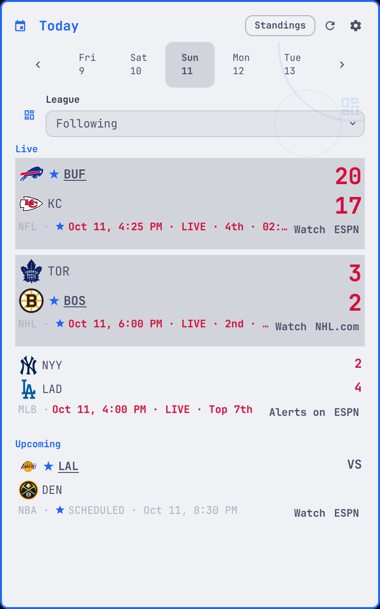
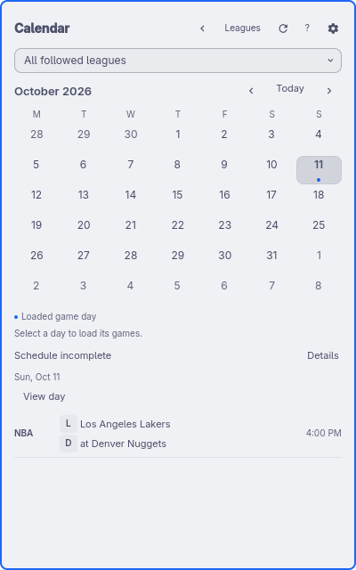
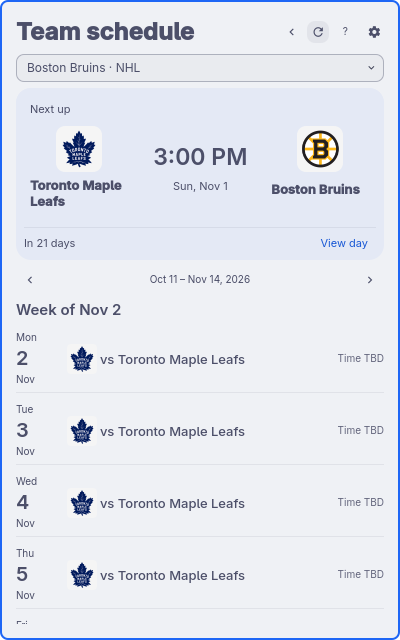
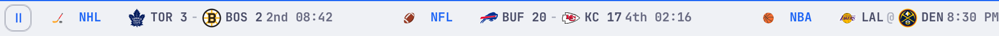

# Sportray

Scores, standings, and game alerts in your Omarchy bar.

Follow your teams, check the next matchup, or open a game's details without
leaving your desktop. Sportray is a native Omarchy / Quattro bar widget with a
compact scores panel and a scrolling ticker.

- **Favorite-first** — Keep favorite teams, watched games, and followed leagues
  together in Following.
- **Eight leagues** — Hockey, football, baseball, basketball, and soccer in one
  league chooser.
- **No account or API key** — Direct provider requests, local preferences, and
  no backend or telemetry.

[Install](#install) · [Follow your teams](#follow-your-teams) · [Scores & standings](#scores-and-standings) · [Ticker & alerts](#ticker-and-alerts) · [Keyboard](#keyboard) · [Troubleshooting](#troubleshooting)

<table>
  <thead>
    <tr><th>Following</th><th>Standings</th><th>Game details</th></tr>
  </thead>
  <tbody>
    <tr>
      <td valign="top" align="center"><a href="screenshots/sportray-following.png"></a></td>
      <td valign="top" align="center"><a href="screenshots/sportray-standings.png"></a></td>
      <td valign="top" align="center"><a href="screenshots/sportray-details.png"></a></td>
    </tr>
  </tbody>
</table>

<table>
  <thead>
    <tr><th>Favorite teams</th><th>Sports &amp; leagues</th><th>Game alerts</th></tr>
  </thead>
  <tbody>
    <tr>
      <td valign="top" align="center"><a href="screenshots/sportray-favorites.png"></a></td>
      <td valign="top" align="center"><a href="screenshots/sportray-leagues.png"></a></td>
      <td valign="top" align="center"><a href="screenshots/sportray-notifications.png"></a></td>
    </tr>
  </tbody>
</table>

_Select an image to enlarge it. Screenshots show illustrative games, standings,
and preferences in the stock Catppuccin Latte theme. Sportray follows your
active Omarchy colors and sizing, with Adwaita Sans in the popup. The bar and
ticker retain the shell font._

## Install

On Omarchy 4 with the Quattro shell:

```bash
omarchy plugin add https://github.com/joega/sportray.git --enable
```

Sportray uses the system Python runtime included by Omarchy. It does not install
packages, request privileged access, create a service, or overwrite user
configuration. This candidate is tested with **Omarchy 4.5.0**, **Quickshell
0.3.2.r7**, and **Qt 6.12**.

Click the bar widget to open today's scores. On Omarchy 4.5, the panel follows
the widget's bar section and supports horizontal and vertical bars.

## Follow your teams

Open **Settings → Favorite teams** to search by team or filter by league.
Favorites stay at the top of the picker and pin their games in league views.
When no teams are selected, a short guide helps you get started. **Review leagues**
explains Enable and Follow; selected teams whose scores are disabled are labeled.
Picking a team never silently enables or follows its league.

**Following** brings together favorite-team games, temporary game watches, and
slates from leagues you follow. Its overview counts the loaded games; **All**,
**Live**, and **Favorites** help narrow a busy day. Live includes intermissions;
Favorites includes favorite-team games. Filters reset to All when you reopen the
panel. **Show all** returns from an empty filter without changing your follows.
Under **Settings → Sports & leagues**:

| Control | What it does |
| --- | --- |
| **Enable** | Fetch the league's scores and make its view available. |
| **Follow** | Include the enabled league in Following and promote it in navigation. |
| **Reorder** | Change followed-league order. Disabling a league also removes it from the followed set. |

Use **Game actions → Alerts** on a score row, or **Alerts** in game details, to receive alerts for that game
without favoriting either team. **Alerts on** marks an active watch. These controls manage game notifications.

## Scores and standings

Use the league dropdown below the dates to switch views. The five-day date
carousel, previous/next arrows, and Today reset let you browse completed and
upcoming slates. On an empty league day, **View day** jumps to its next scheduled
game.

Open the **calendar button** beside the dates, or press **G**, for **All followed
leagues**. Calendar opens as its own page in the same panel, with one header and
a Back action. The month grid lets you choose a day and see its listed games across
enabled leagues you follow. Selecting a day previews its agenda; **View day**
opens that date in Following. **Leagues** opens the controls for choosing what to
follow. Unloaded days remain unknown; markers identify previously loaded games.

Choose a favorite team in the same selector, or select a team name in scores,
game details, or standings, for its **team schedule**. Opening a team's schedule
does not add it to favorites. This view
puts the dated **Next up** matchup first, followed by a list of later games.
There is no month picker in the team view. **View day** opens the team's league
on that date; range arrows let you browse the next or previous 35 days. Aligned
dates, opponents, logos, and start times make the agenda easy to scan; **This
week**, **Next week**, and dated week headings organize longer team schedules.

The global calendar loads only the selected day, with at most one request per
followed league. Team schedules load a 35-day window. Both reuse recent results
during the shell session. Providers may publish only part of a season, especially
playoffs and college schedules. In that case it says **Next listed game** and
labels the incomplete schedule. An unmarked date does not prove there are no games;
unannounced start times show **Time TBD**. Failed updates identify retained data.
**Details** expands coverage or update information inline; **Retry** is available
when an update can be attempted. Back restores the previous view, date, filter,
scroll position, and selected action.

<p><a href="screenshots/sportray-calendar-global.png"></a> <a href="screenshots/sportray-calendar.png"></a></p>

| League | Scores | Standings |
| --- | :---: | :---: |
| NHL | ✓ | ✓ |
| NFL | ✓ | ✓ |
| MLB | ✓ | ✓ |
| NBA | ✓ | ✓ |
| NCAA Football | ✓ | — |
| NCAA Men's Basketball | ✓ | — |
| Premier League | ✓ | ✓ |
| MLS | ✓ | ✓ |

Choose **Standings** in the header, or press **S**, to open the selected league's
table. From Following, choose a league first. **Scores** returns to its games;
**Refresh** updates the table while standings are open.

NFL, MLB, and NBA tables use the provider's **playoff seed order** within each
conference or league; soccer uses table ranks. ESPN tables show the season the
provider returns, including offseason tables. NHL standings use the current local
calendar date, independently of the selected score date. College standings remain
unavailable. Each group shares aligned column headers suited to its sport. Select
a team's star to add or remove a favorite; selecting the table row leaves favorites
unchanged. Select a team name to open its schedule.

Favorite and game-alert changes show a brief confirmation with **Undo**. Use
the button or **Ctrl+Z** outside text fields and open menus to undo the latest
change while it remains available. Other preferences stay unchanged.

### Open a game

Select a loaded score row for its local detail view: score, status, venue, period
or inning totals, team stats, and live situation where the provider supplies them.
Upcoming games can show a bookmaker line and over/under with attribution.
Missing optional sections stay out of the way; long play descriptions wrap and
long period tables scroll horizontally.
Upcoming details emphasize the matchup, start time, venue, and available odds.
Live details put the score and current situation first; completed games show
the result before their scoring breakdown and stats.

Open details follow the existing score feed, preserving scroll and action focus
as data updates. An update message identifies retained scores if a request fails
or the game disappears from the latest slate. **Game actions** keeps team schedules,
alerts, and the source together on each compact score card. The source action opens ESPN
gamecast, MLB.com gameday, or NHL.com gamecenter.
Changed scores briefly highlight when desktop motion is enabled. Initial loads,
retained stale scores, and recycled rows stay quiet.

## Ticker and alerts

The bar indicator highlights favorite-team activity. Its hover text gives more
context, while the ticker scrolls live scores, upcoming games, and recent finals.



- **Pause / Resume** controls ticker motion. Under **Settings → Ticker**, choose
  visibility, top/bottom placement, and scroll speed.
- Hover pauses scrolling without changing manual Pause. Resume continues from
  the same position. Reduced motion keeps the ticker still; a short slate that
  fits on screen also stays still. Hover text includes the full matchup and source.
- Turning the ticker off removes its reserved space at the screen edge.
- Select a ticker game to open its provider page. Select other ticker space to
  open the scores panel. Games without a safe provider link keep the panel action.
- Under **Settings → Notifications**, independently choose game starts, score
  changes, and finals, plus optional pregame reminders and close-game alerts.
- **Send test notification** previews the Omarchy notification channel.

Alerts follow favorite teams and watched games. Requests adapt to the slate and
stay infrequent when nothing is live. Disabling or removing Sportray stops its
background score requests and alerts; a settings save already in progress gets
up to 2.5 seconds to finish.

## Keyboard

| Key | Action |
| --- | --- |
| `[` / `]` | Previous / next day. |
| `T` | Return to today. |
| `G` | Open the global calendar from scores. |
| `S` | Toggle Scores / Standings on a supported league view. |
| `R` | Refresh scores or the open standings table. |
| `N` | Open Settings from scores. |
| `F` | Cycle All / Live / Favorites in Following scores. |
| `Menu` / `Shift+F10` | Open Game actions for the selected score row. |
| `Ctrl+Z` | Undo the latest favorite or alert change outside editors and menus. |
| `?` | Show shortcuts for the current view outside editors and menus. |
| `V` | Review leagues while browsing Favorite teams. |
| `F` / `/` | Filter leagues / search while browsing Favorite teams. |
| Arrow keys | Move through the active chooser, rows, or detail/settings actions. Left/Right scrolls a long scoring table in details. |
| Page Up / Page Down | Scroll game details or page through score rows. |
| Home / End | Jump to the beginning or end of details or score rows. |
| Enter / Space | Activate the selected action. |
| Escape | Return to the previous view, or close the panel. |

In Favorite teams, press Down or Enter from search to browse results; Enter on a
result toggles its favorite state. Editors and open dropdowns own their keys. Tab follows Omarchy's neighboring-panel
navigation rather than cycling through Sportray's actions. Native dropdowns,
Game actions, and the calendar keep their own Tab navigation.
Use the **?** button when shown for the same contextual keyboard help. Escape
closes the help sheet and returns focus to the control you were using.

Inside the global calendar, arrows move between dates, Page Up / Page Down change
months, and Enter previews the focused day. In a team schedule, Page Up / Page Down
change the 35-day range. Tab reaches the selector and matchup actions; Escape
returns to the previous view.

## Data sources and privacy

Scores and team data come directly from NHL, ESPN, and MLB StatsAPI endpoints.
NHL uses its public scoreboard API; MLB uses ESPN with a StatsAPI fallback. Other
supported league scoreboards and team lists use ESPN. Standings use ESPN or NHL.
The global calendar uses daily league scoreboards and MLB StatsAPI. Team schedules
use NHL club schedules, ESPN team schedules, and MLB StatsAPI team/date queries.
Both avoid unsupported ESPN date-range scoreboard requests.

Optional team logos are fetched from reviewed ESPN/NHL asset hosts, validated
for format, byte size, and dimensions, and kept only for the shell session.
NHL uses reviewed ESPN PNGs while preserving NHL team and favorite IDs. Failed or
unmapped logos fall back to readable team text.

Sportray has no backend, account, analytics service, or telemetry. It does not
upload preferences, ask for API keys, or execute downloaded code. It is currently
tested only in the United States; provider availability may vary by region.

## Manage or remove

```bash
omarchy plugin enable io.github.joega.sportray
omarchy plugin disable io.github.joega.sportray
omarchy plugin remove io.github.joega.sportray
```

Removal leaves preferences at
`~/.local/state/omarchy/settings/sportray.json`, so reinstalling keeps your setup.
Remove that file separately for a preference reset. Older Calendar cache files
under `~/.cache/sportray/calendar`, if present, are also retained. Team calendar
results stay only for the shell session.

## Troubleshooting

- **After a code update:** run `omarchy restart shell` to load the new QML.
- **No games:** check that the league is enabled, choose another date, use
  the team calendar to find the next listed game, use **View day**, or select
  **Refresh**.
- **A provider is unavailable:** healthy leagues keep working. Following shows
  league-specific failures and marks retained scores as stale; a failed request
  is not treated as a confirmed empty day. Standings also label retained data
  and provide a retry action.
- **Widget missing:** re-enable it and restart the shell.
- **Preferences:** avoid deleting the state file unless you want to reset your setup.

<details>
<summary>Refresh the documentation screenshots</summary>

Requires the installed Omarchy UI modules, Quickshell, Qt Quick / QtTest,
Adwaita Sans, and JetBrainsMono Nerd Font. Render a review set with:

```bash
python3 tools/capture-readme.py /tmp/sportray-readme
```

Add `--theme catppuccin` for a dark-theme review.
Without an output argument, the tool refreshes the README images and root
`preview.png`. It uses illustrative state, stock theme files, and an isolated
HOME; it does not load or change the installed plugin, desktop theme, or user
preferences. Team logos pass through Sportray's bounded raster helper.
These captures document appearance, not desktop interaction testing.

The calendar image comes from the native interaction fixture:

```bash
SPORTRAY_TEST_ARTIFACT_DIR=/tmp/sportray-ui python3 tests/test-ui-presentation.py
cp /tmp/sportray-ui/ui-light/upcoming.png screenshots/sportray-calendar.png
cp /tmp/sportray-ui/ui-light/calendar-global.png screenshots/sportray-calendar-global.png
```

</details>

## License

[MIT](LICENSE). See [CHANGELOG.md](CHANGELOG.md) for release notes.
